# Tripline

給小團體用的旅遊行程規劃網站。把景點排進每天的時間軸，路線、車程與行前資訊都在同一個地方，旅伴打開就看得懂。

🔗 **立即使用**：[https://trip-planner-dby.pages.dev/](https://trip-planner-dby.pages.dev/)

📱 **iOS / Android 版**：[Tripline Flutter](https://github.com/raychiutw/trip-planner.flutter)（目前只提供原始碼，還沒有商店下載連結）

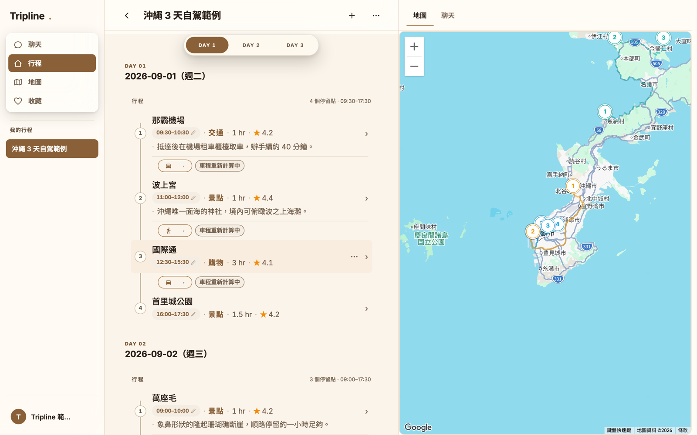

<table>
  <tr>
    <td align="center">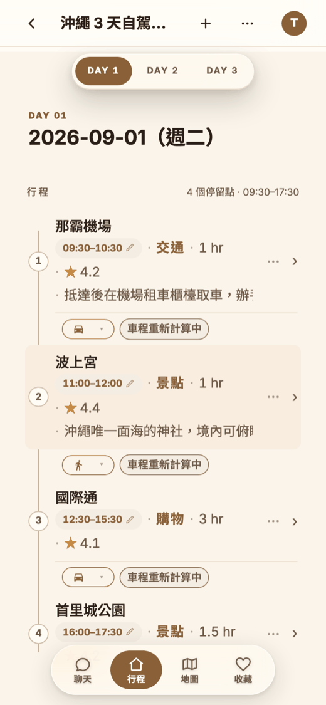 每日時間軸</td>
    <td align="center">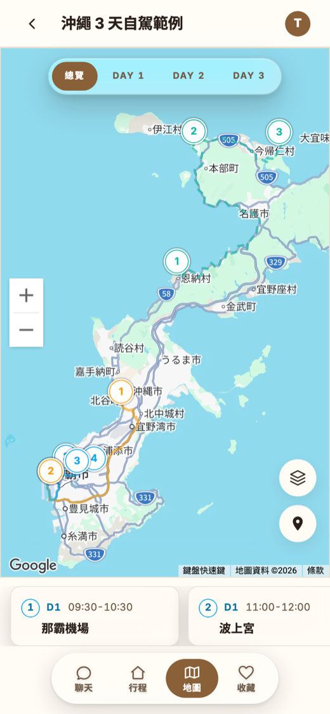 每日路線地圖</td>
    <td align="center">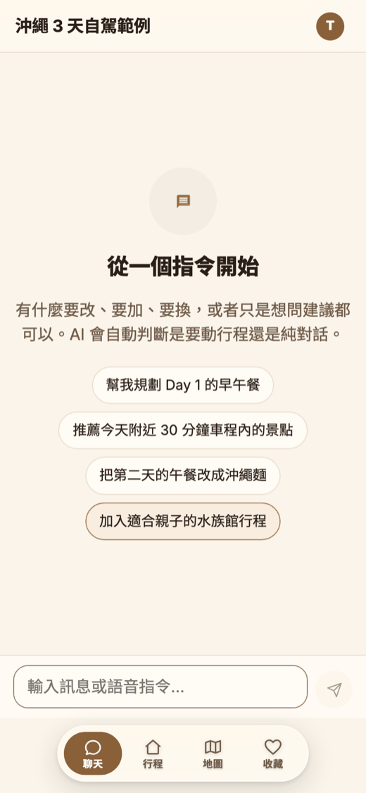 說一句話就改行程</td>
  </tr>
</table>

## 出發前你會反覆做的三件事

### 💬 說一句話就改好

講「把第三天的美國村移到第二天」或「把第二天的午餐改成沖繩麵」，AI 會幫你移動停留點、重算車程，再告訴你改了什麼，不用自己一格一格拖。

### 🗺️ 每天的路線一眼看完

每天的路線用不同顏色畫出來，馬上看出哪天在繞路。地圖頁可以切換一般地圖或衛星圖；用電腦看時，展開時間軸上的停留點，旁邊的地圖會飛到那個點，點地圖上的停留點則能直接看它的詳細資料。

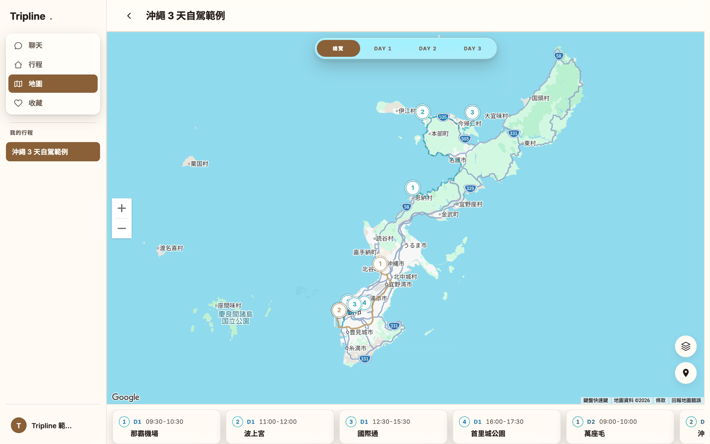

### ✅ 出發前先健檢

時間排太緊、來回繞路、營業時間對不上，AI 健檢會從五個面向掃一遍，出發前就知道哪裡要調整。

## 功能特色

### 排行程

- **每日時間軸**：景點、餐廳、購物與住宿依時間排好，每個停留點都看得到停留多久
- **停留點之間的交通**：開車與步行的時間、距離自動算好，調整順序後跟著更新；公車、地鐵、火車等大眾運輸路段會先估一個時間（沖繩單軌另有估算），也可以自己填實際時間
- **景點資訊**：可以顯示景點的 Google 評分與營業時間（視景點資料而定）
- **正選與備選**：同一個時段可以放一個正選景點和幾個備選，臨時改主意不用重排
- **跨城市行程**：一趟旅程可以分配多個目的地與天數，例如沖繩 3 天、京都 2 天
- **地圖直連**：每個景點一鍵開啟 Google Maps 或 Apple Maps

### 行前準備

- **行程筆記**：航班、住宿、預訂、行前須知與緊急聯絡分類整理
- **探索與收藏**：搜尋景點與餐廳，先收藏起來，之後再排進行程
- **歸檔**：玩回來的行程可以歸檔，清單只留下正在規劃的旅程

<table>
  <tr>
    <td align="center">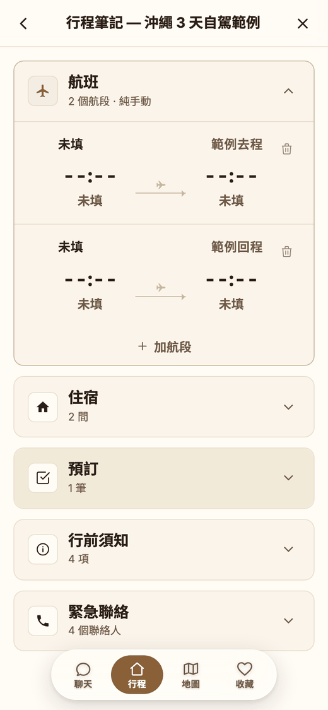 行程筆記</td>
    <td align="center">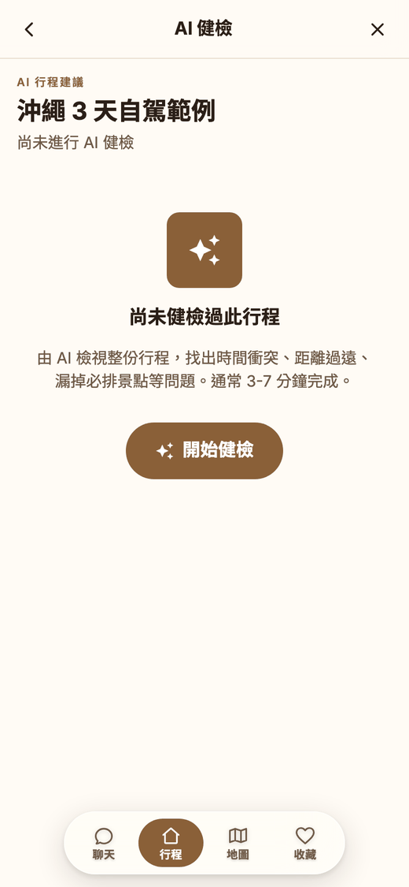 AI 健檢</td>
  </tr>
</table>

### 和旅伴一起

- **共同編輯**：邀請旅伴加入，一起安排同一份行程
- **分享連結**：產生唯讀的分享連結，可設定有效期限、要公開哪些筆記，也能匿名分享
- **列印與匯出**：A4 排版的列印文件，也能下載成 PDF 或 JSON
- **匯入行程**：從 Tripline 下載的 JSON 檔可以再匯入，繼續編排

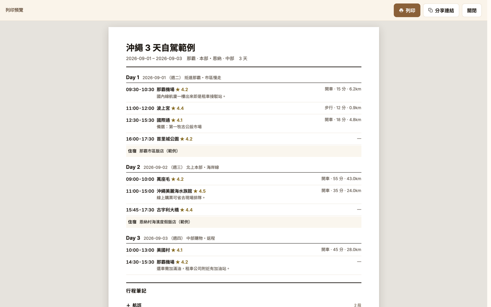

### 隨時隨地

- **手機、平板、桌機都好用**：桌機同時看時間軸與地圖，手機用底部分頁切換
- **深色模式**：淺色、深色或跟隨系統
- **加入主畫面**：可以像 App 一樣從主畫面開啟
- **帳號安全**：查看登入過的裝置，可以登出單一裝置或一次登出其他所有裝置

<table>
  <tr>
    <td align="center">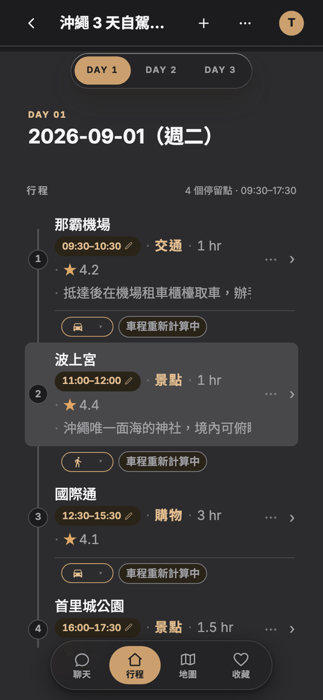</td>
    <td align="center">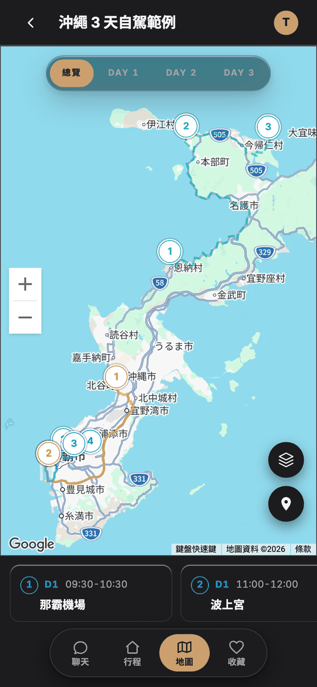</td>
    <td align="center">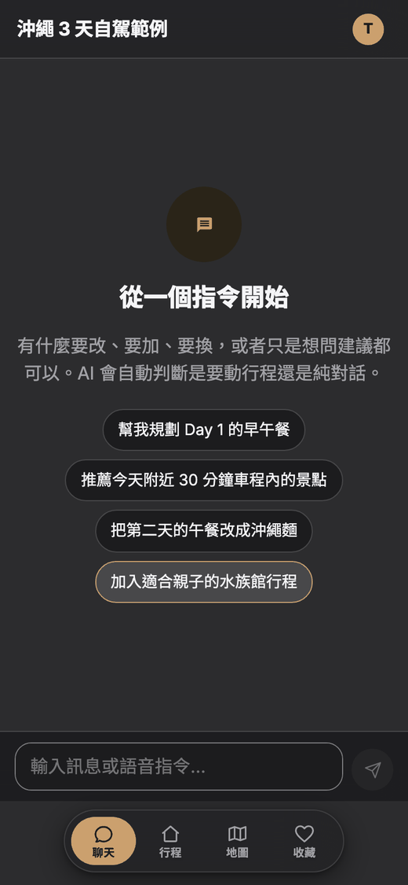</td>
  </tr>
</table>

